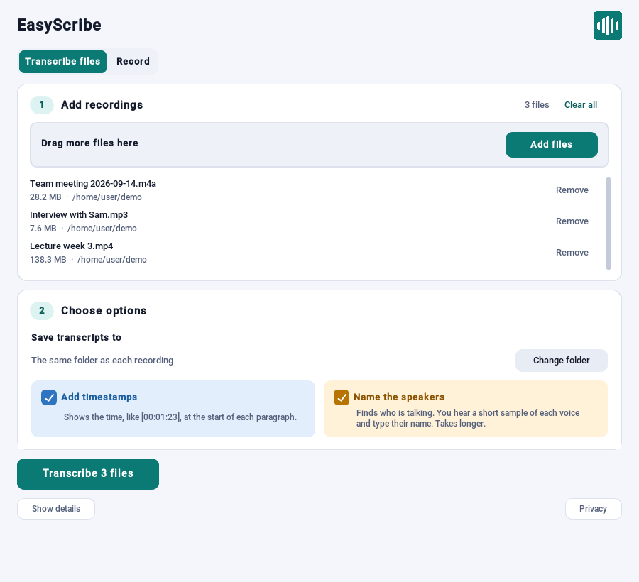
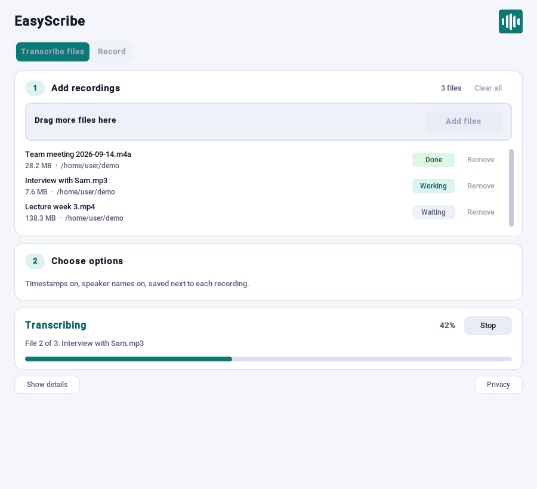
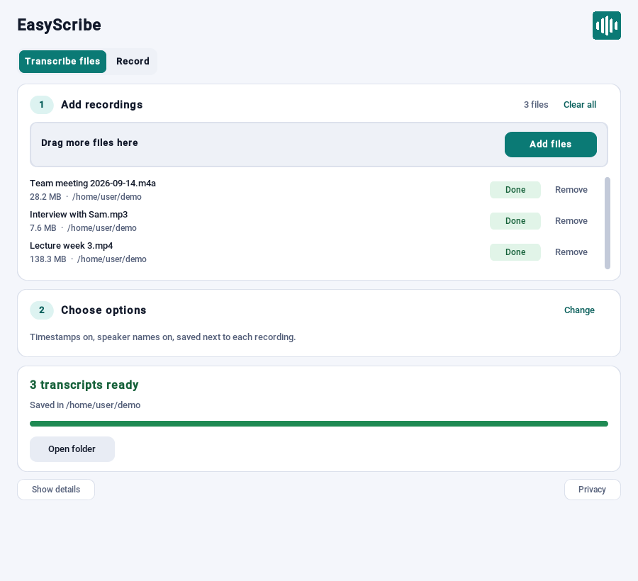
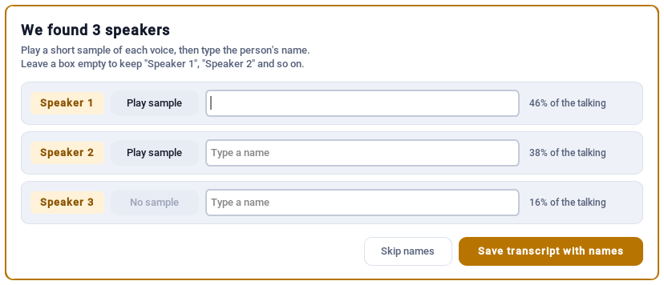
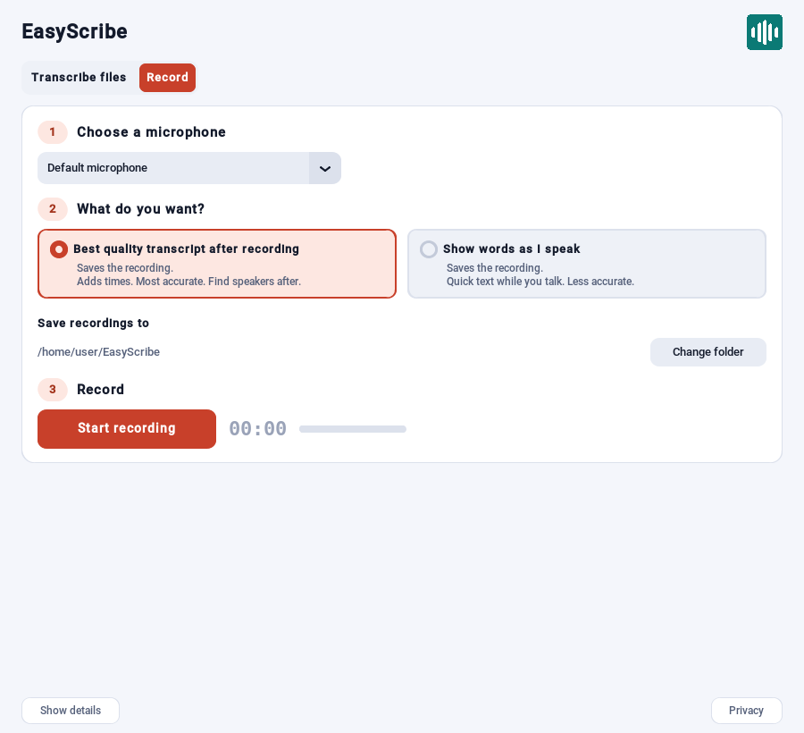
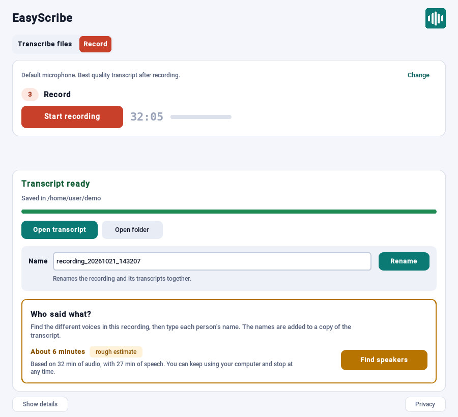
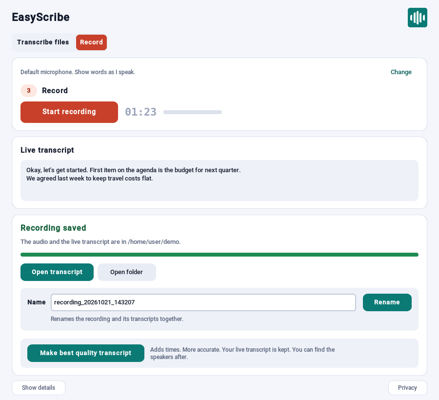
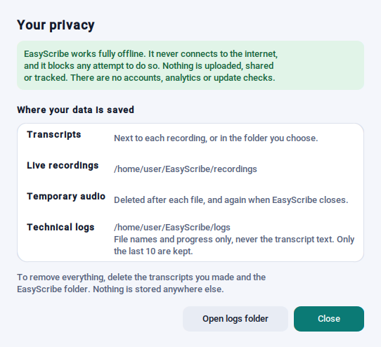

<p align="center">
  
</p>

<h1 align="center">EasyScribe</h1>

<p align="center">
  <b>Turn recordings into text — privately, on your own computer.</b><br>
  Meetings, interviews, lectures and live speech. No internet, no account, no upload.
</p>

<p align="center">
  
</p>

---

## Why EasyScribe?

- **Nothing leaves your computer.** EasyScribe works fully offline. Your audio and transcripts stay on your disk. There are no accounts, no analytics and no update checks.
- **Transcribe any recording.** Audio or video, one file or many at a time.
- **Transcribe as you talk.** Record from your microphone and watch the words appear.
- **Know who said what.** EasyScribe can find the different speakers, and you can give them names.
- **Fast on most PCs.** It uses your graphics card (NVIDIA, AMD or Intel) when it can, and your processor when it cannot.
- **One file, no setup wizard.** Download one `.exe`, double-click it, and start. No admin rights needed.

---

## What it looks like

### Transcribe files

Drag your files onto the window, or select **Choose files**. Then tick the options you want and select **Transcribe**.

Each colour means one thing everywhere in the app: **teal** for files, **coral** for recording, **amber** for speakers, **blue** for timestamps and **green** for done.

<p align="center">
  
</p>

You see the status of each file and the current step. You can stop at any time. If one file fails, the others continue.

<p align="center">
  
</p>

When it is done, open the transcript or the folder with one click. Each transcript is a plain `.txt` file next to its recording (or in a folder you choose).

### Name the speakers

In **Transcribe files**, tick **Name the speakers** to find who is talking. (After a recording, use **Find speakers**; see below.) When the speakers are found, a panel opens in the main window. Play a short sample of each voice and type a name. The names go into the transcript.

<p align="center">
  
</p>

### Record

Select **Record** and choose your microphone. Then choose what you want:

- **Best quality transcript after recording** (the default). EasyScribe records only. When you stop, it makes the transcript at once with the more accurate engine, with times. Then select **Find speakers** to name the speakers. EasyScribe first shows a rough estimate of how long it takes, and you can stop at any time. The names go into a copy, `<name> (speakers).txt`; the first transcript is kept.
- **Show words as I speak**. The words appear as you speak. This is quicker but less accurate.

Both choices save the recording in `Documents\EasyScribe`. To use a different folder, select **Change folder** under **Save recordings to**; EasyScribe remembers it. Select **Start recording**. The small bar next to the timer shows that the microphone hears you.

<p align="center">
  
</p>

When the transcript is ready, you can name the files and find the speakers:

<p align="center">
  
</p>

After a live recording, you can still get the best result: select **Make best quality transcript**. This runs the saved recording through the more accurate engine, with times. Then you can select **Find speakers**. Your live transcript is kept, and the new one is saved as a separate `(best quality).txt` file.

<p align="center">
  
</p>

If your computer stops during a recording, EasyScribe offers to recover the audio the next time it opens.

### Name your files

After a result, the **Name** box shows the file's current name. Change it or add to it, then select **Rename** (or press Enter). You can also ignore it: nothing changes unless you select Rename. A recording and its transcripts are renamed together (`Team meeting.wav`, `Team meeting.txt`, `Team meeting (speakers).txt`). In **Transcribe files**, only the new transcript is renamed; your original file is not changed.

### Your privacy

Select **Privacy** at the bottom of the window to see what EasyScribe stores and where.

<p align="center">
  
</p>

---

## Get started

1. Download `EasyScribe-<version>.exe` from the [Releases](../../releases) page.
2. Put it in any folder you like. A local folder or a USB stick are both fine.
3. Double-click it. The first launch shows **Preparing EasyScribe** while it verifies and unpacks the speech models and ffmpeg once, into `%LOCALAPPDATA%\EasyScribe\runtime\<hash>`. Later launches reuse that cache and start in about a second.
4. Drag recordings onto the window and select **Transcribe**.

There is no install-location picker, no shortcut step and no admin rights. The executable is the whole application. Updates are full-size downloads: close EasyScribe, replace the `.exe`, and start it again. The new version extracts its own runtime once and removes the old cache after a successful launch.

> **Windows SmartScreen:** EasyScribe is not code-signed, so Windows may warn the first time. Select **More info → Run anyway**. You can also right-click the `.exe`, select **Properties → Unblock**, then **OK** before the first start.

> **Portable mode:** create an empty file named `EasyScribe.portable` next to the `.exe`. Settings, logs, temporary audio and the extracted runtime are then kept in `EasyScribe-data` beside the executable instead of `%LOCALAPPDATA%`.

---

## What you get

| Option | Example output |
|---|---|
| Plain text | `Hello, this is the first sentence. And here is another.` |
| **Add timestamps** | `[00:00:14]` at the start of each block of speech |
| **Name the speakers** | `[Alice]` / `[Bob]` at each change of speaker |

With both options:

```
[00:00:01] [Alice]
Hello, this is the first sentence.

[00:00:14] [Bob]
After a pause, the next block starts here.
```

**Supported files:** mp4, mkv, mov, avi, webm, mp3, wav, m4a, flac, ogg, opus, aac.

---

## Troubleshooting

| Problem | What to do |
|---|---|
| SmartScreen blocks the `.exe` | Select **More info → Run anyway**, or unblock the file first (**Properties → Unblock**). The app is not signed yet. |
| The first launch takes a while | That launch verifies and unpacks the bundled models once. Later launches reuse the cache and start quickly. |
| **Preparing EasyScribe** stops with an error | Download the `.exe` again. If it still fails, delete `%LOCALAPPDATA%\EasyScribe\runtime` and start once more. |
| "Name the speakers" is grey | The speaker models are missing from the runtime cache. Download the `.exe` again. |
| No microphones in the list | Check your microphone in the Windows sound settings. |
| Antivirus flags the `.exe` | Unsigned single-file apps are sometimes flagged by mistake. Add an exclusion only for a file downloaded from this project's Releases page. |
| Transcription is slow | File transcription uses the GPU through Vulkan when the driver supports it; on the CPU it is slower than the Python release. Close other large apps, or use a shorter recording. **Show details** shows the engine and thread count. |
| An unfinished recording is found at startup | Choose **Yes** to rebuild it as a `.wav`; the raw audio is kept if you choose **No**. |

---
---

# Technical details

The sections below are for developers and IT staff.

## Inference engines

| Task | Engine | Device |
|---|---|---|
| File transcription | [whisper.cpp](https://github.com/ggml-org/whisper.cpp) `whisper-cli`, large-v3-turbo q5_0, beam size 5 | Vulkan GPU when available, else CPU |
| File transcription (in-process fallback) | `whisper-rs` with the same GGUF model, beam size 5 | CPU |
| File transcription (fallback) | [sherpa-onnx](https://github.com/k2-fsa/sherpa-onnx) Whisper large-v3-turbo int8, VAD + greedy | CPU |
| Live transcription | sherpa-onnx, Silero VAD chunks | CPU |
| Speaker diarization | sherpa-onnx: pyannote segmentation-3.0 + WeSpeaker ResNet34-LM | CPU |

File transcription runs the bundled `whisper-cli` as a child process, exactly like v3.2.3. It probes Vulkan devices, prefers a dedicated GPU, remembers one that failed, and retries once on the CPU with `-ng`. A driver crash only kills the child, so the app and the CPU fallback survive. The linked `whisper-rs` engine remains as a fallback when the bundled CLI cannot start (development builds and damaged payloads), and is exercised by the selftest. **Show details** reports the engine and thread count.

Speaker diarization also runs in a child process of the same exe, so Stop is immediate and its memory is reclaimed when it exits.

Audio is decoded with the bundled ffmpeg to 16 kHz mono. Recordings write raw PCM plus a JSON sidecar, so an interrupted recording can be rebuilt as a WAV on the next start.

## Offline guarantee and privacy (GDPR)

EasyScribe never sends data off the computer. How this is enforced:

- **All models are local.** They are extracted from the executable into the runtime cache. There are no model downloads at runtime.
- **No network code.** The Rust workspace has no HTTP, DNS or socket client. `crates/easyscribe-core/tests/offline.rs` fails if a network-capable crate becomes a runtime dependency.
- **ffmpeg and ffprobe read local files only.** They run with `-protocol_whitelist file`, so a playlist or concat file cannot make them fetch a URL.
- **Temporary audio is deleted.** Converted WAV files, speaker samples and decoder output are removed after each file, at startup and at exit.
- **No accounts, telemetry or update checks.**

| Data | Location | Kept until |
|---|---|---|
| Transcripts | Next to each recording, or the folder you choose | You delete them |
| Recordings | `Documents\EasyScribe`, or the folder you choose | You delete them |
| Settings, crash-recovery audio | `%LOCALAPPDATA%\EasyScribe` (or `EasyScribe-data` in portable mode) | You delete them |
| Technical logs | the same EasyScribe data folder. File names and progress only, never transcript text | The last 10 are kept |
| Runtime cache | `%LOCALAPPDATA%\EasyScribe\runtime\<hash>` | Replaced on update |

To remove everything, delete your transcripts and the `%LOCALAPPDATA%\EasyScribe` folder (or `EasyScribe-data` in portable mode).

## Distribution layout

```
EasyScribe-<version>.exe
  ├── Windows executable (Rust, whisper.cpp + sherpa-onnx linked in)
  ├── ZIP payload (models, ffmpeg, whisper.cpp GGUF, assets, licenses)
  └── 128-byte footer (version, offsets, SHA-256 of the payload)
```

The executable is a normal Windows program with an appended archive; Windows ignores the overlay. On first launch the app verifies the payload hash, extracts it into `%LOCALAPPDATA%\EasyScribe\runtime\v1-<hash>`, writes a `.complete` marker, and removes runtimes left by older payloads. Re-launches open the cache directly. Nothing is unpacked to `%TEMP%`.

**Updates.** Each release is a full executable. The payload hash is the cache key, so a new version extracts once and later starts reuse the new cache. There is no separate update bundle or download-time model check.

**Why extract at all?** whisper.cpp, ffmpeg and the models must exist as real files on disk. Extracting once keeps launches fast without an installer, registry entries or admin rights.

## Project layout

```
Cargo.toml                     Workspace: core, app, packer
crates/easyscribe-core/        Domain logic: config, ffmpeg, VAD, sherpa,
                               whisper.cpp, transcription, mic, recovery,
                               rename, settings, outputs, single-exe payload
crates/easyscribe/             Rune UI: views, app state, workers, dialogs
crates/easyscribe-pack/        Appends the payload and writes the footer
scripts/build-windows.ps1      Local single-exe build
.github/workflows/rune.yml     Linux tests and Windows check
.github/workflows/rune-release.yml
                               Windows draft pre-release build
docs/rewrite/                  Behaviour, UI and packaging reference specs
models/ whispercpp/            Development model folders (ignored by git)
```

The Python v3.2.3 tree remains the behavioural oracle; it is not part of the Rust build.

## Building

Requirements for a Windows build:

- Windows 10/11 x64 and Rust stable with the MSVC toolchain.
- Static sherpa-onnx **1.12.9** MSVC libraries (`sherpa-onnx-v1.12.9-win-x64-static`) with `SHERPA_LIB_PATH` pointing at the extracted folder that contains `lib`. The 1.12.9 version matches the C API that `sherpa-rs` 0.6.8 binds; 1.13.x changed that struct layout.
- `models/`, `ffmpeg/` (or `tools/ffmpeg/`) and `whispercpp/` with `ggml-large-v3-turbo-q5_0.bin` plus the Vulkan `whisper-cli.exe` and its DLLs. The release workflow builds these from whisper.cpp v1.8.6; to use an existing build, copy `whisper.cpp\build\bin\Release\*` into `whispercpp\`.

```powershell
pwsh -File scripts/build-windows.ps1
# -> dist\EasyScribe.exe
```

The script builds the app and packer together with the `release-static` feature (static sherpa libraries, static MSVC runtime, CPU-only in-process fallback) and bundles the Vulkan `whisper-cli.exe` as the primary file engine, then appends the payload. GitHub Actions runs the same build from **Actions → Rune Windows Release**, dispatched from the `rune-rewrite` branch; it publishes a draft pre-release tagged with a hyphenated version such as `v3.2.3-rust.10`.

Local checks:

```bash
cargo test --workspace
cargo fmt --all -- --check
cargo clippy --workspace --all-targets
```

The app version is the workspace version (`3.2.3`).

---

## License

This project is released under the MIT License.

The app includes third-party programs and models. Each one keeps its own license:

- FFmpeg (GPL v3). The source and a written offer are in `licenses/THIRD-PARTY-NOTICES.txt`.
- whisper.cpp, ONNX Runtime, the Whisper weights, Silero VAD and pyannote segmentation (MIT).
- sherpa-onnx (Apache 2.0).
- Rune and the Rust runtime dependencies (MIT / Apache 2.0).
- The WeSpeaker ResNet34-LM speaker model (CC BY 4.0, trained on VoxCeleb).

See [`licenses/THIRD-PARTY-NOTICES.txt`](licenses/THIRD-PARTY-NOTICES.txt) and the texts in [`licenses/`](licenses/). The build copies them into the payload inside the executable.
